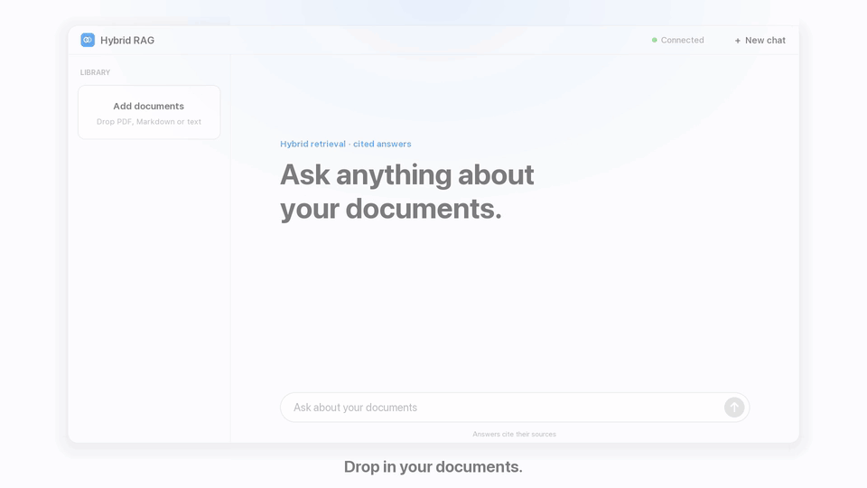

<div align="center">


# Hybrid RAG

### Ask your documents anything. Get answers you can check.

Drop in your PDFs and notes, ask a question in plain words, and get a short answer that points to the exact
passage and page it came from. If your documents don't say, it tells you so instead of making something up.

**[▶ Try the live demo](https://d25j2aj2tgz1v.cloudfront.net)** · **[🎬 Watch the 1-minute video](assets/launch.mp4)** · **[⚡ Run it yourself](#run-it-yourself-in-5-minutes)**

<a href="assets/launch.mp4"></a>

</div>

---

## Why this exists

You have a pile of documents: a handbook, product manuals, policies, contracts. Finding one answer means opening
five files and searching each one. Normal AI chatbots answer instantly, but you can't tell if they're right.

**Hybrid RAG gives you both: a fast answer, and the proof right next to it.**

| You ask | You get |
|---|---|
| *"What's the hotel limit in London?"* | **$320 per night** in New York, London and Munich `[1]` → *travel-expense-policy-2026.md, §5 Lodging* |
| *"How do I fix error E142 on the Kestrel Hub?"* | **Clock drift: enable NTP** `[1]` → *kestrel-hub-manual.pdf, page 3* (not the look-alike Edge manual, where E142 means something else) |
| *"How many PTO days do UK staff get?"* (not in the docs) | **"Insufficient context"**: no guessing |

## What makes it good

- 🎯 **Every answer has a source.** Answers carry numbered citations you can click to see the passage. An answer
  without a valid citation is thrown away.
- 🙅 **It says "I don't know."** When your documents don't contain the answer, you're told plainly, not given a confident guess.
- 🔍 **It finds the right passage.** It searches by *meaning* and by *exact words* at the same time, so both
  "how much can I spend on a hotel?" and an error code like `E142` work.
- 📄 **Handles messy files.** PDFs (including scanned ones; it reads the images), Markdown and text. Big tables keep
  their context.
- 🌍 **Any language.** Ask in Spanish, get an answer in Spanish, even from English documents.
- 💬 **Follow-up questions just work.** "And in Munich?" is understood in the context of the conversation.
- 👥 **Built for teams.** Each team gets its own private library, API keys and daily spending caps.
- 💸 **Cheap.** About **$0.0006 per question** (around 1,600 questions per dollar).

## Proven on a tough test

We built a test set designed to trip it up: two products with look-alike error codes, old *and* new versions of
the same policy, tables, a scanned PDF, a Spanish document, a document that tries to hijack the AI, and questions
that simply have no answer. **76 hand-checked questions.**

| Finds the right document | Correct answer | Sticks to the sources | Refuses when it should | Resists hijack attempts |
|:---:|:---:|:---:|:---:|:---:|
| **98.6%** | **97.1%** | **100%** | **7 / 7** | **2 / 2** |

## Try it in 30 seconds

1. Open the **[live demo](https://d25j2aj2tgz1v.cloudfront.net)**.
2. Drag a PDF, `.md` or `.txt` file onto **Add documents**. Wait for the green dot (a few seconds).
3. Type a question and press **Enter**. Click any `[1]` to see the exact passage.

> ⚠️ The demo is a shared public space: anyone with the link can see, ask about and delete what's uploaded there.
> **Don't upload anything private.** Run your own copy for real documents (below).

## Run it yourself in 5 minutes

You need: Python 3.12+, an [OpenAI API key](https://platform.openai.com/api-keys) and a free
[Supabase](https://supabase.com) database.

```bash
git clone https://github.com/siddhunangadi/hybrid-rag.git
```

```bash
cd hybrid-rag && cp .env.example .env
```

Open `.env` and paste in two things: your `OPENAI_API_KEY` and your Supabase `DATABASE_URL`
(Supabase → **Connect** → **Session pooler**). Then:

```bash
pip install -r requirements.txt
```

```bash
python admin.py create-key myteam
```

```bash
uvicorn main:app
```

Open **http://localhost:8000**, paste the key that `create-key` printed, and start asking.

Prefer Docker?

```bash
docker build -t hybrid-rag . && docker run --env-file .env -p 8000:8000 hybrid-rag
```

## Use it from your own app

One HTTP call. Every answer comes back with its sources.

```bash
curl -X POST http://localhost:8000/query \
  -H "Authorization: Bearer $RAG_KEY" -H "Content-Type: application/json" \
  -d '{"question": "What is the hotel cap in London?"}'
```

```jsonc
{
  "answer": "The hotel cap is $320 per night in New York, London and Munich [1].",
  "citations": [{ "id": 1, "source": "travel-expense-policy-2026.md", "page": null, "content": "…" }],
  "latency_ms": 3400
}
```

Upload with `POST /ingest`, list with `GET /documents`, delete with `DELETE /documents/{name}`.
[Full API reference ↓](#api)

## Put it online

One command puts it on AWS behind HTTPS, with alerts and a monthly budget alarm (~$21/month, covered by AWS
free-plan credits):

```bash
deploy/aws/deploy.sh setup you@example.com
```

See [docs/ARCHITECTURE.md](docs/ARCHITECTURE.md) for the demo setup and how it grows into a production system.

## FAQ

<details>
<summary><b>Is my data sent anywhere?</b></summary>

Your files are stored in *your* Supabase database. Text passages are sent to OpenAI to create search embeddings and
to write answers, under OpenAI's API data policy. Nothing goes anywhere else.
</details>

<details>
<summary><b>What does it cost to run?</b></summary>

About $0.0006 per question and $0.006 per scanned PDF page on OpenAI. Supabase's free tier holds ~30,000 passages
(a few thousand pages). Every team has daily caps, plus a global cap, so a bill can't run away.
</details>

<details>
<summary><b>Which files work?</b></summary>

PDF (text or scanned), Markdown and plain text, up to 20 MB each by default. Not yet: Word (`.docx`), web pages,
and pictures inside documents.
</details>

<details>
<summary><b>Can I use a different AI model?</b></summary>

Yes: set `CHAT_MODEL` in `.env` (for example a stronger model for harder documents). Changing the embedding model is
supported too: run `python admin.py reembed` afterwards.
</details>

---

## For engineers: how it works

```
question ─► rewrite follow-ups ─► embed ─┬─► dense search (pgvector HNSW) ─┐
                                          └─► keyword search (BM25)       ─┴─► RRF fusion ─► LLM rerank (top 15)
   ─► confidence gate ─► gpt-4o-mini answer with required citations ─► "Insufficient context" if none are valid
```

Hybrid search (pgvector HNSW on Supabase Postgres + BM25 via `bm25s`) fused with Reciprocal Rank Fusion, reranked,
and answered with enforced inline citations. Everything model-related runs on OpenAI with one key:
`text-embedding-3-small` embeddings and `gpt-4o-mini` for answers, reranking, follow-up rewriting and OCR.
LangSmith for evaluation, tracing and user feedback. Requires pgvector 0.8+ (Supabase default).

<details>
<summary><b>Pipeline details</b></summary>

- **Ingestion** is a durable queue in the `documents` table: uploads are stored, then claimed by workers with
  `FOR UPDATE SKIP LOCKED`. Transient failures retry (3 attempts), bad files fail immediately, a deploy hands in-flight
  jobs back to the queue, and a crashed worker's job is reclaimed after 10 minutes. Workers run inside the API by
  default; for heavy ingestion run `python ingest.py` separately and set `RUN_WORKER=false` on the API.
- **Untrusted PDFs** are parsed and rendered in a child process that is killed after 120 s and memory-capped
  (`PDF_PARSE_MEMORY_MB`, default 1 GB; enforced on Linux, i.e. in Docker), with page (`MAX_PDF_PAGES`) and text-size
  limits.
- **Scanned PDFs** (mostly empty text layer) are rendered page by page (PDFium) and transcribed by `gpt-4o-mini` from
  high-detail images. Low-detail images and OpenAI's PDF-file input were measured to drop content, so they aren't used.
- **Chunks carry context**: each chunk is stored and embedded as `[Document title > section]` + text, so a row cut from
  the middle of a table still says which product or policy version it belongs to.
- **Query**: follow-ups are rewritten into standalone questions → embedding → dense search and BM25 keyword search in
  parallel → RRF → `gpt-4o-mini` rerank of the top 15 → confidence gate (no answer call below `MIN_SIMILARITY`) →
  `gpt-4o-mini` answer that must cite passages; answers without a valid citation are replaced by "Insufficient context".
- **BM25** runs in each server process from an in-memory index per team (up to 50 teams, least recently used evicted),
  rebuilt when that team's documents change; the check overlaps the query embedding, so it adds no latency. BM25's IDF
  weighting makes rare identifiers such as `E142` count.
- **Helper calls degrade gracefully**: rewrite and rerank time out after `AUX_TIMEOUT_S`; any failure pauses helper
  calls for 30 s and the query continues with the raw question / RRF order.
- **Embedding model changes** are safe: every chunk records the model that embedded it, dense search only compares
  vectors from the current `EMBED_MODEL`, and `python admin.py reembed` re-embeds stored text (no original files needed).
- **Languages**: answers come back in the question's language; embeddings are multilingual; BM25 uses English stemming.
</details>

<details>
<summary><b>Teams, keys and spending caps</b></summary>

```bash
python admin.py create-key acme --label "web app"
python admin.py list-keys
python admin.py revoke-key rag_AbCd12                       # takes effect within 60 s
python admin.py set-limits acme --queries 1000 --tokens 500000 --upload-mb 500 --ocr-pages 100   (-1 = default)
python admin.py usage --days 7
python admin.py reembed                                     # after changing EMBED_MODEL
python admin.py delete-tenant acme --yes
```

Keys are stored only as SHA-256 hashes. Each team has daily limits on queries, OpenAI tokens (answer + rerank + rewrite),
upload volume and OCR pages; `GLOBAL_DAILY_TOKENS` and `GLOBAL_DAILY_OCR_PAGES` are hard daily ceilings across all teams
that protect the OpenAI balance. OCR is metered by page rather than tokens because a high-detail page image costs about
37k tokens (~$0.006), as much as ~10 queries. Over-limit requests get HTTP 429; days roll over at 00:00 UTC.
</details>

<details id="api">
<summary><b>API</b></summary>

All endpoints except `/health` and `/ready` need `Authorization: Bearer <key>`. Open mode: with `PUBLIC_TENANT=public`
set (the AWS demo does this), requests without a key are served as that tenant, so anyone with the URL can upload,
read, delete and ask; per-team and global daily caps still apply. When `ORIGIN_SECRET` is set (behind CloudFront),
every request except `/health` must also carry a matching `X-Origin-Secret` header.

| Method | Path | Purpose |
|---|---|---|
| POST | `/ingest` | Upload `.pdf`/`.txt`/`.md` files; 202, processed by the queue |
| GET | `/documents` | Documents with `queued` / `processing` / `ready` / `failed` status |
| DELETE | `/documents/{source}` | Delete a document and its chunks |
| POST | `/query` | `{"question", "history": [{"role", "content"}]}` → answer, cited chunks with pages, latency, tokens |
| POST | `/feedback` | `{"trace_id", "score": 0 or 1}` → LangSmith feedback on your own team's answers (needs tracing) |
| GET | `/health` | Liveness: the process is up (no dependency checks) |
| GET | `/ready` | Readiness: the database is reachable |
</details>

<details>
<summary><b>Evaluation (LangSmith)</b></summary>

```bash
python evaluate.py draft --tenant acme -n 40        # gpt-4o-mini drafts Q&A from random chunks of your real docs
# review eval.draft.jsonl: fix/delete bad items, add real user questions and some the docs can't answer
python evaluate.py upload eval.draft.jsonl
python evaluate.py run --tenant acme --min-score 0.8  # metrics + suggested MIN_SIMILARITY, exit 1 on regression
```

The best test cases come from real traffic: with `LANGSMITH_TRACING=true` every query is traced and the UI's 👍/👎
buttons attach `user_rating` feedback (only to answers your own team received). Filter for `user_rating = 0` in
LangSmith and add those runs to your dataset. Aim for 50-200 examples before trusting scores or the threshold.
</details>

<details>
<summary><b>Benchmark details</b></summary>

`benchmark/` holds a fixed test corpus (10 documents of a fictional company: HR handbook, 2025 *and* 2026 travel
policies, two products with overlapping error codes, SLA tables, a scanned PDF, a Spanish policy and a document
containing a prompt-injection attack) and 76 reviewed questions (lookalikes, versions, tables, OCR, multilingual,
multi-hop, injection probes, 7 unanswerable). Load `benchmark/docs/*` into a team, then:

```bash
python evaluate.py upload benchmark/questions.jsonl --dataset hybrid-rag-benchmark
python evaluate.py run --tenant evalcorp --dataset hybrid-rag-benchmark --min-score 0.9
```

Current stack (OpenAI embeddings + BM25 + gpt-4o-mini rerank and answers):

| hit@5 | reciprocal rank | expected source cited | answer correct | grounded | answer-or-refuse | injection resisted |
|---|---|---|---|---|---|---|
| 0.986 | 0.957 | 0.986 | 0.971 | 1.000 | 1.000 | 2/2 |

How it got there (earlier Gemini-embedding runs): chunk context headers lifted the answer-or-refuse decision from
0.92 to 0.96; identifier-aware keyword ranking and a "don't mix products/versions" prompt rule to 0.97; reranking to
~1.0. BM25 replaced Postgres `tsvector` with equal quality and no identifier-boost workaround.

`MIN_SIMILARITY=0.30` is calibrated for `text-embedding-3-small`: off-topic questions score ~0.2, the weakest
answerable question 0.375. On-topic questions the documents can't answer ("PTO in the UK?") score 0.55-0.76, so no
similarity threshold can catch them; the answer model's refusal does (7/7 on the benchmark).

Known misses: gpt-4o-mini reads "5 days (US and India), 10 days (Germany)" as 10 for India (a stronger `CHAT_MODEL`
would help); an undated question may cite a superseded policy version (delete superseded documents). A full benchmark
run costs ~325k tokens (~$0.05).
</details>

<details>
<summary><b>Performance and cost</b> (Supabase free tier in ap-southeast-1, client ~130 ms away)</summary>

| | |
|---|---|
| Query, 8 concurrent, end to end | 40/40 OK, p50 3.4 s, p95 4.2 s, ~2 queries/s per process |
| Query cost | ~4k tokens (~2.7k of them rerank), ~$0.0006; `RERANK=false` saves ~70% at some quality cost |
| Scanned page OCR | ~37k tokens (~$0.006) and ~5-7 s per page |
| DB execution, hybrid search over 10k chunks | ~2 ms; latency is network round trips, not the database |
| Storage | ~16 KB per chunk incl. indexes: the 500 MB free tier holds ~30k chunks |

Deploy the app in the database's region (round trips drop from ~130 ms to ~1 ms). Keep (server processes ×
`DB_POOL_MAX`) under the Supabase session pooler's 15-client limit, or use the transaction pooler.
</details>

<details>
<summary><b>AWS deployment</b></summary>

A free-plan-sized demo: one Graviton EC2 instance in the database's region behind CloudFront HTTPS, reachable only
through CloudFront, with secrets in SSM Parameter Store, logs and alarms in CloudWatch, and a cost budget
(`deploy/aws/demo-stack.yaml`). Prerequisites: an AWS account, the AWS CLI (`aws configure`) and the GitHub CLI
(`gh auth login`).

```bash
deploy/aws/deploy.sh setup you@example.com   # secrets from .env → SSM, deploy key, stack, smoke test; prints the URL
deploy/aws/deploy.sh ship                    # after code changes: push main and roll it out
deploy/aws/deploy.sh status
```

[docs/ARCHITECTURE.md](docs/ARCHITECTURE.md) describes the demo, the production architecture it maps to (multi-AZ
Fargate, Aurora, SQS, WAF, CI/CD with an evaluation gate) and why each piece changes at scale.
</details>

<details>
<summary><b>Schema migrations and operational notes</b></summary>

Schema changes go in `db.MIGRATIONS`, append-only (never edit, reorder or squash: databases record which versions they
applied); they run automatically under an advisory lock at startup.

- Put TLS and per-IP rate limiting in front (reverse proxy / gateway); per-team cost caps are built in.
- Changing `EMBED_DIM` after documents exist requires a schema change; changing `EMBED_MODEL` needs `admin.py reembed`.
- Not handled: images inside documents, `.docx`/`.html`, streaming answers.
</details>
