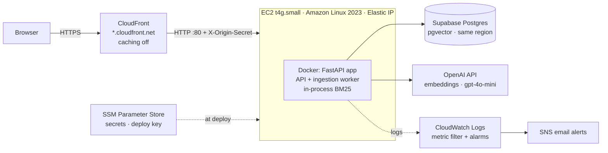
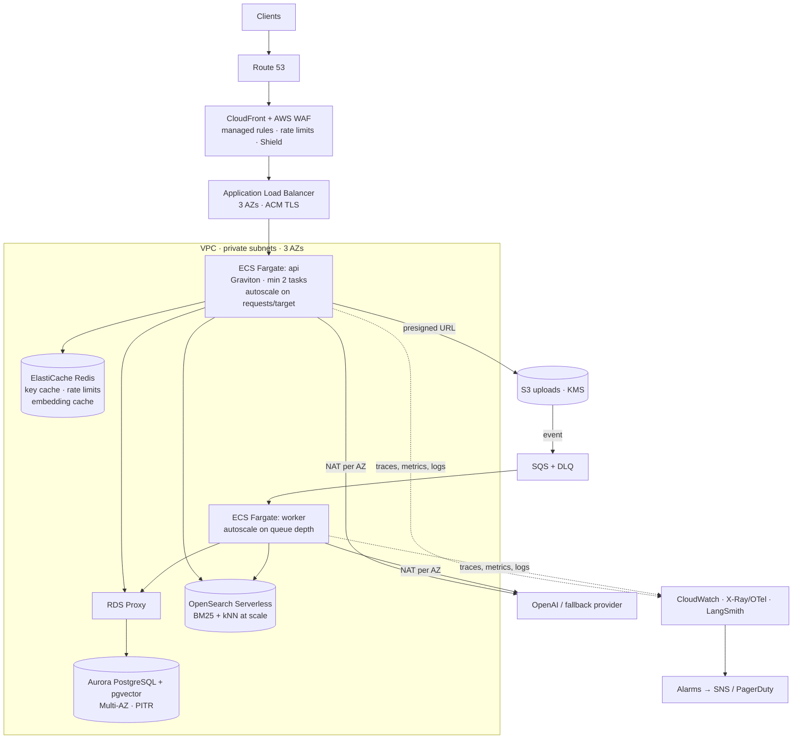

# Architecture

This project runs in two shapes:

- **A. Demo deployment (what is live):** one ARM instance behind CloudFront, sized to run on AWS free-plan credits.
- **B. Production architecture (what it would become):** multi-AZ, autoscaled, observable and recoverable, for real
  customer traffic.

The application code is the same in both; the differences are infrastructure. Section C maps every demo shortcut to
its production counterpart and explains why.

---

## A. Demo deployment (ap-southeast-1)

| Concern | How the demo handles it |
|---|---|
| HTTPS without a domain | CloudFront's `*.cloudfront.net` certificate; HTTP is redirected to HTTPS |
| Origin exposure | Security group admits port 80 only from CloudFront's managed prefix list; the app also requires a secret `X-Origin-Secret` header that only our distribution adds, so other distributions can't reach it either |
| Admin access | No SSH port; AWS Systems Manager Session Manager and Run Command |
| Secrets | SSM Parameter Store SecureString, rendered into a root-only `.env` at deploy; never in git or the image |
| Latency | Same region as the Supabase database: ~1 ms round trips instead of ~130 ms from a laptop |
| Memory (2 GB) | One web process, one ingestion worker, PDF sandbox capped at 768 MB, 2 GB swap |
| Host failure | CloudWatch alarm on the system status check triggers EC2 auto-recovery; guest failure triggers a reboot |
| App crash | Docker `restart: unless-stopped`; container health check on `/health` |
| Stuck ingestion | Worker logs queue depth every minute; alarm if a document waits more than 15 min or reports stop |
| Cost control | AWS Budget on gross cost (credits excluded) with email alerts; `standard` CPU credits (no surplus billing); in-app per-team and global OpenAI token caps |
| Deploys | `deploy.sh ship`: push to GitHub, then SSM Run Command makes the instance pull, build (on ARM) and restart, followed by a smoke test through CloudFront |

**Request path.** CloudFront terminates TLS, adds the origin secret and forwards every request uncached with all
viewer headers (the API key travels in `Authorization`). The app authenticates the team, charges its daily budget,
runs hybrid retrieval (pgvector + BM25 fused with RRF, then an LLM rerank) and returns a cited answer. Uploads are
stored in Postgres and processed by the in-process worker.

**Approximate monthly cost** (list prices; covered by new-account free-plan credits):

| Item | ~USD/month |
|---|---|
| EC2 t4g.small (on-demand) | 15 |
| EBS gp3 20 GB | 2 |
| Public IPv4 address | 4 |
| CloudFront, CloudWatch Logs, SSM, SNS, Budgets | 0 (free tiers at demo volume) |
| **Total AWS** | **~21** |
| OpenAI | ~$0.0006 per query; ~$0.006 per scanned page |
| Supabase | Free tier (pauses after a week idle, no point-in-time recovery) |

**Known demo limits (deliberate):** single instance in one AZ (seconds of downtime per deploy, minutes on host
failure); no WAF (paid on pay-as-you-go CloudFront; per-team rate and cost caps exist in the app); database on the free
tier without point-in-time recovery; ingestion queue and search index live in the same process and database as the API.

---

## B. Production architecture

### Components and why

- **Edge: CloudFront + WAF + Shield Standard.** TLS at the edge, AWS managed rule groups (common exploits, bad inputs),
  rate-based rules per IP and per API key, DDoS absorption. Route 53 + ACM for a real domain.
- **Compute: ECS Fargate behind an ALB across three AZs.** No servers to patch; the `api` service keeps at least two
  tasks in different AZs and scales on requests per target; the `worker` service scales on queue depth. Rolling or
  blue/green deploys with the ECS deployment circuit breaker roll back automatically on failed health checks. Graviton
  for ~20% better price-performance. The app already supports this split (`RUN_WORKER=false` on the API,
  `python ingest.py` for workers) and drains gracefully (jobs in flight are re-queued on SIGTERM).
- **Ingestion: S3 + SQS with a dead-letter queue.** Clients upload straight to S3 with presigned URLs (no large bodies
  through the API); S3 events enqueue jobs; poison files land in the DLQ after N attempts. The demo's Postgres-backed
  queue (`FOR UPDATE SKIP LOCKED`) is correct and fine to thousands of jobs a day; SQS removes it from the database's
  load and scales independently.
- **Database: Aurora PostgreSQL with pgvector, Multi-AZ, behind RDS Proxy.** Automatic failover, point-in-time
  recovery, read replicas for search traffic, and pooled connections so autoscaled tasks can't exhaust Postgres
  connections. (Staying on Supabase is also valid: Team/Enterprise plan with PITR and read replicas, transaction pooler.)
- **Search at scale.** BM25 runs in-process today, rebuilt per team when its documents change; that is ideal up to tens
  of thousands of chunks per team. Beyond that, move keyword + vector search to OpenSearch Serverless (or `pg_search`
  inside Postgres) so every task shares one index.
- **Shared cache: ElastiCache Redis.** API-key lookups, rate-limit counters and query-embedding cache shared across
  tasks (today each process has its own 60 s key cache).
- **LLM layer.** The circuit breaker, timeouts, per-team token budgets and global ceilings are already in the code.
  Production adds a secondary provider (Azure OpenAI or Bedrock) behind the same breaker, and a higher OpenAI usage tier.
- **Secrets and identity.** Secrets Manager with rotation and KMS; per-service IAM task roles with least privilege; VPC
  endpoints for S3, ECR, Secrets Manager and CloudWatch; NAT gateway per AZ for egress to the LLM APIs.
- **Observability.** Structured JSON logs (already emitted), CloudWatch dashboards and alarms, OpenTelemetry/X-Ray for
  distributed traces, LangSmith for LLM traces, user feedback and evaluation. Alarms page on-call via PagerDuty.
- **Delivery.** GitHub Actions with OIDC (no long-lived AWS keys) → build and scan the image → ECR → deploy to staging →
  run the LangSmith benchmark as a quality gate → promote to production. Infrastructure as code for everything;
  staging and production in separate AWS accounts under AWS Organizations, with GuardDuty and Security Hub enabled.

### Capacity and the real bottleneck

- **The LLM quota binds first, not compute.** A query uses ~4,000 OpenAI tokens (about 2,700 of them for reranking), so
  `max queries per minute ≈ tokens-per-minute quota ÷ 4,000`. A 2,000,000 TPM quota supports ~500 queries/minute
  (~8/s). Raising the OpenAI usage tier is a launch prerequisite; disabling the reranker cuts tokens ~70% at a small
  quality cost.
- **Compute scales horizontally.** Requests are I/O-bound and async; measured ~2 queries/s per process at 8 concurrent
  clients with 130 ms network round trips. Co-located with the database, each task handles more; add tasks for the rest.
- **Database work is small.** Hybrid search over 10k chunks executes in ~2 ms; latency is network round trips. RDS Proxy
  (or a transaction pooler) keeps connection counts bounded as tasks scale.

### Reliability targets

| Objective | Target | How |
|---|---|---|
| Availability | 99.9% monthly | Multi-AZ tasks and database, health-checked load balancing, automatic rollback |
| Query latency | p95 < 5 s | Bounded timeouts (20 s × 2 attempts on interactive LLM calls, 5 s on helpers), helper circuit breaker |
| Ingestion freshness | 95% of documents ready < 5 min | Queue-depth autoscaling, DLQ for poison files |
| Data loss (RPO) | ≤ 5 minutes | Aurora PITR; S3 versioning for uploads |
| Recovery (RTO) | ≤ 1 hour region-level | Cross-region snapshot copies, IaC to rebuild the stack |

### Failure modes already handled in code

| Failure | Behavior |
|---|---|
| Deploy or scale-in stops a worker mid-job | Job is handed back to the queue immediately; crashed workers' jobs are reclaimed after 10 min |
| Same file re-uploaded while processing | Each upload gets a new job id; a stale job's result can't overwrite the newer one |
| Malicious or huge PDF | Parsed and rendered in a memory-capped child process, killed after 120 s; page and text limits |
| LLM helper slow or rate-limited | Times out, pauses helper calls for 30 s, query continues with the plain ranking |
| Team or service overspends | Daily caps per team (queries, tokens, uploads, OCR pages) and global ceilings return HTTP 429 |
| Embedding model changed | Each chunk records its model; vectors from other models are never compared; `admin.py reembed` |
| Database blip | Liveness (`/health`) stays up, readiness (`/ready`) fails, so the process isn't killed for a dependency outage |
| Schema drift | Append-only migrations under an advisory lock; startup refuses a database with unknown migrations |

### Approximate production baseline cost

| Item | ~USD/month |
|---|---|
| CloudFront + WAF | 20-40 |
| ALB | 25 |
| Fargate (2 api + 1 worker, Graviton, 1 vCPU/2 GB) | 90 |
| NAT gateways (2 AZs, before data) | 70 |
| Aurora Serverless v2 Multi-AZ (low floor) + RDS Proxy | 120-200 |
| ElastiCache Redis (small) | 25 |
| CloudWatch, Secrets Manager, S3, SQS, ECR | 20-40 |
| **AWS baseline** | **~400-500** (OpenSearch Serverless adds ~$350+ when needed) |
| OpenAI | ~$0.0006 per query, ~$0.006 per scanned page |

---

## C. Demo → production mapping

| Demo | Production | Why the change matters at scale |
|---|---|---|
| One EC2 instance, one AZ | ECS Fargate across 3 AZs behind an ALB | Survives an AZ outage; zero-downtime rolling deploys; no OS patching |
| Docker restart + EC2 auto-recovery | ALB health checks, ECS replacement, deployment circuit breaker | Unhealthy tasks are replaced and bad releases roll back automatically |
| `*.cloudfront.net`, no WAF | Route 53 domain, ACM, WAF managed rules and rate limiting | Branded HTTPS, protection from abuse before it reaches the app |
| Security group + origin secret | Private subnets, ALB only, VPC endpoints | Nothing in the VPC is internet-reachable |
| Supabase free tier | Aurora Multi-AZ + RDS Proxy (or Supabase paid with PITR) | Failover, point-in-time recovery, pooled connections |
| Uploads stored in Postgres, Postgres queue | S3 presigned uploads + SQS with DLQ | Large files bypass the API; queue scales independently; poison messages isolated |
| In-process BM25 per team | OpenSearch Serverless or `pg_search` | One shared index; no per-process rebuilds or memory growth |
| Per-process key cache | ElastiCache Redis | Consistent revocation and rate limits across many tasks |
| Parameter Store | Secrets Manager with rotation | Automatic credential rotation and audit |
| SSM Run Command deploy from a laptop | GitHub Actions (OIDC) → ECR → staging → eval gate → prod | Repeatable, reviewed, quality-gated releases |
| CloudWatch logs + 3 alarms | Dashboards, traces, SLO alerts to on-call | Problems are detected before customers report them |
| Budget alert + in-app token caps | Same, plus per-tenant billing and higher LLM quota tier | Cost tracks revenue; the LLM quota is sized to demand |
